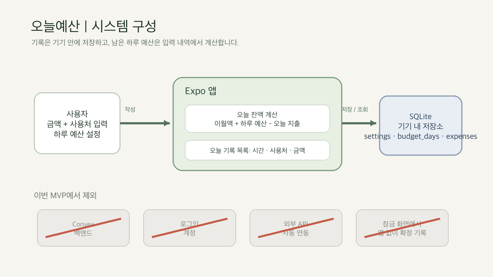

# 오늘예산 — 시스템 설계

## Overview
Expo 앱 하나와 기기 내 SQLite 데이터베이스로 만든다. 사용자가 하루 예산과 지출 금액·사용처를 입력하고, 앱은 오늘 남은 금액과 기록 목록을 계산한다. 로그인, 서버, 외부 데이터 API가 필요 없다. 앱은 iOS와 Android를 대상으로 하며, SQLite는 Expo Go에 포함된다. [Expo SQLite](https://docs.expo.dev/versions/latest/sdk/sqlite/)

## Diagram

## Core flow
1. 앱이 한국 날짜(Asia/Seoul)의 오늘 예산 행을 확인한다. 없으면 가장 최근 잔액에 하루 예산을 더해 새 행을 만든다. 중간에 앱을 열지 않은 날짜도 하루 예산을 누적한다.
2. 사용자가 금액과 사용처를 입력하고 저장한다.
3. 앱이 지출을 SQLite에 저장한 뒤, 오늘 지출 합계와 남은 예산(`이월액 + 오늘 예산 - 오늘 지출`)을 다시 읽어 화면을 갱신한다.
4. 사용자는 오늘 목록에서 사용처와 기록 여부를 확인한다. 안 쓴 예산은 다음 날짜의 이월액이 된다.

## Data
- `settings`: `id=1`, `daily_budget`(원). 설정 행은 하나뿐이다.
- `budget_days`: `day`(Asia/Seoul `YYYY-MM-DD`, 기본 키), `carry_in`, `allowance`, `created_at`. 날짜마다 한 행이다.
- `expenses`: `id`(앱 생성 UUID 유사 식별자, 기본 키), `day`, `amount`(원 정수), `purpose`, `created_at`. 지출 행은 ID로 구분한다. 같은 금액·시각이어도 별도 지출일 수 있으므로 금액을 고유키로 쓰지 않는다.

## Data sources
- 예산과 지출: 사용자가 앱 화면에 직접 입력한다. `scripts/prove_local_sqlite.py`가 예시 데이터를 실제 SQLite에 쓰고 다시 조회한 결과를 [`samples/local-sqlite-response.json`](samples/local-sqlite-response.json)에 저장한다. 이 증명은 호스트의 SQLite로 저장·조회 경로를 확인하며, Expo 앱 자체를 폰에서 실행한 녹화는 아니다. 별도 호출 제한·비용·권한은 없다. 데이터베이스는 기기 안에만 있어 재설치·기기 변경 때 사라질 수 있다. 백업·동기화는 MVP 범위 밖이다.
- 날짜: 기기의 시각을 `Asia/Seoul`로 변환해 일자 경계를 정한다. 서버 시각 API는 부르지 않는다.

## Decisions
### 지출 저장은 기기 안에 둔다
선택지는 Convex 서버, AsyncStorage, SQLite다. SQLite를 선택했다. 지출을 날짜별 합계와 목록으로 함께 읽고, 서버와 계정 없이 폰에서 바로 기록할 수 있다. 대신 기기 간 동기화와 자동 백업은 없다.

### 지출 기록에는 사용처를 받는다
금액만 저장하면 피드백에서 지적한 “무엇을 샀는지 모름”이 남는다. 짧은 사용처 입력을 필수로 한다. 입력 한 칸이 추가되어 기록이 귀찮아질 수 있다.

### 잠금 화면 확정 입력은 뺀다
앱 위젯, 개발 빌드, 별도 네이티브 저장 경로를 추가하는 대신 한 화면의 빠른 입력과 즉시 확인을 먼저 만든다. 위젯은 다음 버전에서 남은 예산 표시와 앱 진입만 검증한다. 핵심 흐름을 좁히는 대신 잠금 화면에서 직접 기록하는 편의는 포기한다.
